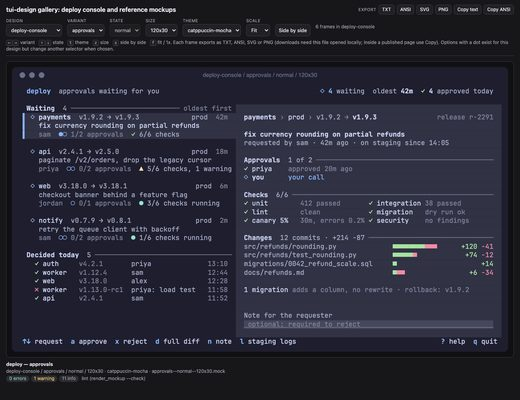
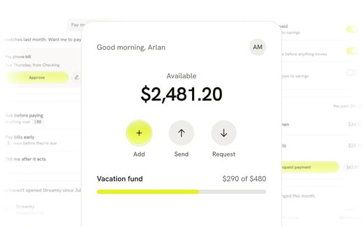
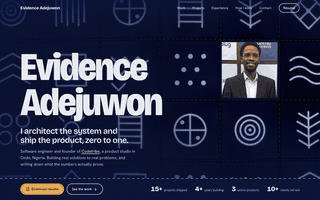
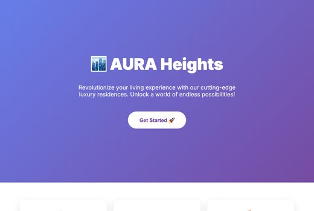
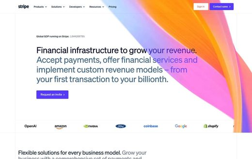

# Awesome Claude Design Skills

[中文](README.zh-CN.md)

Open-source **design skills and tools for Claude Code, Codex and other coding agents**: better UI and frontend style, design systems, Figma and design-tool MCP, design to code, graphics and posters. 188 repos, each one read and security-graded by [Agent Skills Hub (agentskillshub.top)](https://agentskillshub.top?utm_source=github&utm_medium=awesome-list).

Live page with filters: **[https://agentskillshub.top/best/ai-design/](https://agentskillshub.top/best/ai-design/?utm_source=github&utm_medium=awesome-list)** · refreshed every 8 hours

## Which one to install

We ran 10 of these end to end (10 gave a result). This is what we would pick; the [full test](#tested) is below.

- 🥇 **For a look that is not the default: [taste-skill](https://github.com/Leonxlnx/taste-skill)**  
  Both builds passed all seven checks and shared almost nothing with the no-skill page: its own typeface, a cooler palette, and a second build that dared an orange accent.
- 🥈 **For a different result each time: [hallmark](https://github.com/Nutlope/hallmark)**  
  All seven checks twice, little in common with the default, and its two builds differ from each other: one flat and technical, one editorial with a serif headline.
- 🥉 **For one fixed identity: [nothing-design-skill](https://github.com/dominikmartn/nothing-design-skill)**  
  The same dot-matrix look both times, unlike anything else here. That is the point of it, and the limit: check the phone layout, one build scrolled sideways.

**Changed nothing you can see in a still page:** skills (it is about motion; fonts, colours and layout matched the no-skill page); Skills (both builds matched the no-skill page on all four).

Whichever you pick: none of the 22 pages had the old AI look (purple gradient, gradient text, emoji icons, centred hero), with or without a skill. The sameness now is quieter: teal on cream, text left, a status card right.

*Ranked by how little a build shares with the page Claude Code made with no skill (headline font, body font, accent family, background family), then by the seven page checks, then GitHub stars. This counts sameness, not taste: look at the pictures. Two builds per skill, one brief.*

## What these skills make

<table>
<tr>
<td align="center" valign="top" width="33%"><b>🎨 Frontend design</b> 96 repos   Rules and styles that make generated interfaces look designed. <a href="#type-ui"><b>View the list →</b></a></td>
<td align="center" valign="top" width="33%"><b>📐 Design systems</b> 48 repos   Tokens, themes and component specs an agent follows. <a href="#type-system"><b>View the list →</b></a></td>
<td align="center" valign="top" width="33%"><b>🔌 Figma & design tools</b> 18 repos  Figma, Penpot, Canva and other design tools, driven by an agent. <a href="#type-tool_mcp"><b>View the list →</b></a></td>
</tr>
<tr>
<td align="center" valign="top" width="33%"><b>🧱 Design to code</b> 10 repos   Designs, screenshots and mockups turned into frontend code. <a href="#type-to_code"><b>View the list →</b></a></td>
<td align="center" valign="top" width="33%"><b>🖼 Graphics & brand</b> 12 repos  Posters, social images, logos and brand assets. <a href="#type-graphics"><b>View the list →</b></a></td>
<td align="center" valign="top" width="33%"><b>🔍 Design review</b> 4 repos   Design critique: accessibility, consistency, AI-looking output. <a href="#type-review"><b>View the list →</b></a></td>
</tr>
</table>

## Contents

- [🧪 Tested end to end](#tested)
- [🎨 Frontend design](#type-ui) (96)
- [📐 Design systems](#type-system) (48)
- [🔌 Figma & design tools](#type-tool_mcp) (18)
- [🧱 Design to code](#type-to_code) (10)
- [🖼 Graphics & brand](#type-graphics) (12)
- [🔍 Design review](#type-review) (4)

## How a repo gets on the list

1. It helps an agent produce visual design: UI and frontend style, design systems, graphics. A component library with no AI in it, or a general image generator, does not count.
2. It is software someone can install or run, not a list of links or a placeholder.
3. It has a README. Without one it cannot be graded.
4. At 50 stars or more it is listed on topic alone. Under 50 it must also clear a README quality bar (shows it working, one-command start, a concrete outcome, complete docs), and have 5 stars.

The questions are answered by a decision model reading each README, not by hand. A repo near a cut-off can land on either side; open an issue if one is misfiled.

## 🧪 Tested end to end

On 2026-10-10 we ran 10 of these skills. Each built the same landing page twice in a throwaway sandbox, driven by Claude Code (Claude Opus 5.5): a made-up app, fixed copy, the design left open. Claude Code with no skill built it twice as well. Nothing here is a taste score. A browser measured each page: seven checks any landing page should pass, and four things that make pages look alike (headline font, body font, accent colour family, background family), compared with the no-skill pages and between a skill's own two builds.

**What we found:** None of the 22 pages had the old AI look (a purple accent, gradient text, emoji icons, a centred hero), with or without a skill. The default now is teal on cream with a serif headline, and 2 of 10 skills reproduced it on all four counts; 4 shared one or none. Every skill passed at least 6.5 of the 7 checks.

*The first screen of each skill's first build; the page built with no skill is top left.*

| # | Skill | ★ | Shares with the no-skill page (of 4) | Its two builds share (of 4) | Checks passed (of 7) | Failed | Headline font |  |
|---|---|---|---|---|---|---|---|---|
| 1 | [taste-skill](https://github.com/Leonxlnx/taste-skill) | 93,722 | 0.5/4 | 3/4 | 7.0/7 | - | Geist | [evidence](https://agentskillshub.top/best-runs/design/Leonxlnx__taste-skill.html) |
| 2 | [ui-ux-pro-max-skill](https://github.com/nextlevelbuilder/ui-ux-pro-max-skill) | 134,020 | 0.5/4 | 3/4 | 6.5/7 | no sideways scroll on a phone | Varela Round | [evidence](https://agentskillshub.top/best-runs/design/nextlevelbuilder__ui-ux-pro-max-skill.html) |
| 3 | [hallmark](https://github.com/Nutlope/hallmark) | 29,767 | 1.0/4 | 2/4 | 7.0/7 | - | Hanken Grotesk / Newsreader | [evidence](https://agentskillshub.top/best-runs/design/Nutlope__hallmark.html) |
| 4 | [nothing-design-skill](https://github.com/dominikmartn/nothing-design-skill) | 2,808 | 1.0/4 | 4/4 | 6.5/7 | no sideways scroll on a phone | Doto | [evidence](https://agentskillshub.top/best-runs/design/dominikmartn__nothing-design-skill.html) |
| 5 | [huashu-design](https://github.com/alchaincyf/huashu-design) | 24,688 | 1.5/4 | 1/4 | 7.0/7 | - | Archivo / Hind | [evidence](https://agentskillshub.top/best-runs/design/alchaincyf__huashu-design.html) |
| 6 | [claude-design-system-prompt](https://github.com/Trystan-SA/claude-design-system-prompt) | 1,978 | 1.5/4 | 3/4 | 7.0/7 | - | Bricolage Grotesque | [evidence](https://agentskillshub.top/best-runs/design/Trystan-SA__claude-design-system-prompt.html) |
| 7 | [baoyu-design](https://github.com/JimLiu/baoyu-design) | 4,260 | 2.0/4 | 2/4 | 7.0/7 | - | Instrument Serif / Young Serif | [evidence](https://agentskillshub.top/best-runs/design/JimLiu__baoyu-design.html) |
| 8 | [styleseed](https://github.com/bitjaru/styleseed) | 973 | 2.0/4 | 1/4 | 7.0/7 | - | Figtree / Inter | [evidence](https://agentskillshub.top/best-runs/design/bitjaru__styleseed.html) |
| 9 | [skills](https://github.com/emilkowalski/skills) | 44,260 | 4.0/4 | 4/4 | 7.0/7 | - | Fraunces | [evidence](https://agentskillshub.top/best-runs/design/emilkowalski__skills.html) |
| 10 | [Skills](https://github.com/MengTo/Skills) | 6,666 | 4.0/4 | 4/4 | 7.0/7 | - | Fraunces | [evidence](https://agentskillshub.top/best-runs/design/MengTo__Skills.html) |

[All results, prompts and scripts](https://github.com/zhuyansen/agent-skills-hub/blob/main/ops/design-runs/RESULTS.md) · [https://agentskillshub.top/best/ai-design/#test-results](https://agentskillshub.top/best/ai-design/?utm_source=github&utm_medium=awesome-list#test-results)

## 🎨 Frontend design

[Open this type on the live page, sorted by stars →](https://agentskillshub.top/best/ai-design/?utm_source=github&utm_medium=awesome-list#type-ui)

<table><tr>
<td align="center" valign="top"> <a href="https://github.com/oil-oil/oil-ui">oil-oil/oil-ui</a></td>
<td align="center" valign="top"> <a href="https://github.com/kimsh-1/deck-factory">kimsh-1/deck-factory</a></td>
<td align="center" valign="top"> <a href="https://github.com/sva-admin/sv-academy-prom-design">sva-admin/sv-academy-prom-design</a></td>
</tr></table>

| Repo | Stars | What it does | Security |
|---|---:|---|---|
| [nextlevelbuilder/ui-ux-pro-max-skill](https://github.com/nextlevelbuilder/ui-ux-pro-max-skill) | 140.7k | An AI skill that provides design intelligence for building professional UI/UX across multiple platforms. | [SAFE](https://agentskillshub.top/skill/nextlevelbuilder/ui-ux-pro-max-skill/?utm_source=github&utm_medium=awesome-list) |
| [Leonxlnx/taste-skill](https://github.com/Leonxlnx/taste-skill) | 102.8k | Agent skills that give coding agents taste: art direction, reference images and a browser check instead of generic AI pages | [SAFE](https://agentskillshub.top/skill/Leonxlnx/taste-skill/?utm_source=github&utm_medium=awesome-list) |
| [emilkowalski/skills](https://github.com/emilkowalski/skills) | 49.8k | Skills for Designers and Engineers. | [SAFE](https://agentskillshub.top/skill/emilkowalski/skills/?utm_source=github&utm_medium=awesome-list) |
| [Nutlope/hallmark](https://github.com/Nutlope/hallmark) | 35.3k | Anti-AI-slop design skill for Claude Code, Cursor, and Codex. | [SAFE](https://agentskillshub.top/skill/Nutlope/hallmark/?utm_source=github&utm_medium=awesome-list) |
| [alchaincyf/huashu-design](https://github.com/alchaincyf/huashu-design) | 26.5k | Huashu Design 3.0 · 在 agent 里打一句话，拿回能交付的设计：网页 / App 原型 / 可编辑 PPTX / 动画 / 信息图 · 六个候选挑三个方向 · 84 种带样张的风格库 · 越用越懂你的外观账本与设计体检 · HTML-native design skill f… | [SAFE](https://agentskillshub.top/skill/alchaincyf/huashu-design/?utm_source=github&utm_medium=awesome-list) |
| [MengTo/Skills](https://github.com/MengTo/Skills) | 7.0k | Agent skills for designers and builders using Codex, Claude, Cursor, and other AI coding agents | [SAFE](https://agentskillshub.top/skill/MengTo/Skills/?utm_source=github&utm_medium=awesome-list) |
| [JimLiu/baoyu-design](https://github.com/JimLiu/baoyu-design) | 4.5k | Run Claude Design locally as an Agent Skill — Cursor, Claude Code & more. Produce polished UI mockups, prototypes, decks & wireframes as self-contain… | [SAFE](https://agentskillshub.top/skill/JimLiu/baoyu-design/?utm_source=github&utm_medium=awesome-list) |
| [nateherkai/scroll-craft](https://github.com/nateherkai/scroll-craft) | 4.1k | An agent skill for building premium, immersive, scroll-driven websites. Works with Codex, Claude Code, and other coding agents. Also available as a C… | [SAFE](https://agentskillshub.top/skill/nateherkai/scroll-craft/?utm_source=github&utm_medium=awesome-list) |
| [Appllama/appllama-skills](https://github.com/Appllama/appllama-skills) | 3.0k | A builder, not just a researcher. Agent skills that turn top-grossing app patterns into native-quality mobile screens. | [SAFE](https://agentskillshub.top/skill/Appllama/appllama-skills/?utm_source=github&utm_medium=awesome-list) |
| [dominikmartn/nothing-design-skill](https://github.com/dominikmartn/nothing-design-skill) | 2.8k | A Claude Code skill for generating UI in the Nothing design language. Monochrome, typographic, industrial. | [SAFE](https://agentskillshub.top/skill/dominikmartn/nothing-design-skill/?utm_source=github&utm_medium=awesome-list) |
| [oil-oil/oil-ui](https://github.com/oil-oil/oil-ui) | 2.4k | UI design skill for Claude Code, Codex and other AI agents: explore distinct directions, compare them side by side, refine against real screenshots.… | [SAFE](https://agentskillshub.top/skill/oil-oil/oil-ui/?utm_source=github&utm_medium=awesome-list) |
| [bergside/typeui](https://github.com/bergside/typeui) | 2.2k | Build better UI with AI | [SAFE](https://agentskillshub.top/skill/bergside/typeui/?utm_source=github&utm_medium=awesome-list) |
| [dickwu/apple-design-skill](https://github.com/dickwu/apple-design-skill) | 2.0k | Cross-platform UI/UX design reviewer based on Apple HIG. Works with Flutter, Tauri, Electron, React Native. Compatible with Claude Code, Cursor, Code… | [SAFE](https://agentskillshub.top/skill/dickwu/apple-design-skill/?utm_source=github&utm_medium=awesome-list) |
| [zanwei/design-dna](https://github.com/zanwei/design-dna) | 2.0k | Turn reference UIs (images, screenshots, URLs) into quantified Design DNA JSON—tokens, qualitative style, visual effects—then generate matching UI fr… | [SAFE](https://agentskillshub.top/skill/zanwei/design-dna/?utm_source=github&utm_medium=awesome-list) |
| [Trystan-SA/claude-design-system-prompt](https://github.com/Trystan-SA/claude-design-system-prompt) | 2.0k | Reverse-engineered system prompt and skill library that turns an LLM into an opinionated, accessibility-aware, AI-slop-resistant design collaborator. | [SAFE](https://agentskillshub.top/skill/Trystan-SA/claude-design-system-prompt/?utm_source=github&utm_medium=awesome-list) |
| [agiwhitelist/auteur](https://github.com/agiwhitelist/auteur) | 1.0k | The Claude Code skill that directs a website like a film. Commit-sheet, generated assets, build, and an executable anti-slop linter that gates every… | [SAFE](https://agentskillshub.top/skill/agiwhitelist/auteur/?utm_source=github&utm_medium=awesome-list) |
| [bitjaru/styleseed](https://github.com/bitjaru/styleseed) | 990 | Open-source design-method engine for Claude Code, Codex & Cursor. 23 agent skills for fixed design judgment, multiple grammars, semantic palettes, re… | [SAFE](https://agentskillshub.top/skill/bitjaru/styleseed/?utm_source=github&utm_medium=awesome-list) |
| [superdesigndev/superdesign-skill](https://github.com/superdesigndev/superdesign-skill) | 904 | The design skill for Claude Code, Cursor and any coding agent. Stop shipping AI-slop UI: turn it into shippable, tasteful frontend. Install: npx skil… | [SAFE](https://agentskillshub.top/skill/superdesigndev/superdesign-skill/?utm_source=github&utm_medium=awesome-list) |
| [carmahhawwari/ui-design-brain](https://github.com/carmahhawwari/ui-design-brain) | 901 | A Cursor skill that gives AI agents real UI component knowledge — best practices, layout patterns, and design-system conventions for 60+ interface co… | [SAFE](https://agentskillshub.top/skill/carmahhawwari/ui-design-brain/?utm_source=github&utm_medium=awesome-list) |
| [xiaopu-ai/web-design](https://github.com/xiaopu-ai/web-design) | 801 | A Claude Code SKILL for designing beautiful, consistent web pages — spec first, code second. | [SAFE](https://agentskillshub.top/skill/xiaopu-ai/web-design/?utm_source=github&utm_medium=awesome-list) |
| [ItsssssJack/power-design](https://github.com/ItsssssJack/power-design) | 739 | A Claude skill for slides that don't look like AI made them. Brand DNA × 20 codified design principles. | [SAFE](https://agentskillshub.top/skill/ItsssssJack/power-design/?utm_source=github&utm_medium=awesome-list) |
| [AThevon/genjutsu](https://github.com/AThevon/genjutsu) | 680 | Creative coding skills for Claude Code, claude.ai and Cowork. Motion, micro-interactions and design systems across Web (GSAP, Motion, Three.js, CSS),… | [SAFE](https://agentskillshub.top/skill/AThevon/genjutsu/?utm_source=github&utm_medium=awesome-list) |
| [pulkitxm/claude-directory](https://github.com/pulkitxm/claude-directory) | 600 | Open-source AI interfaces built with Claude (Fable 5) including hero sections, GLSL shaders, design systems, animations, 3D components and and landin… | [SAFE](https://agentskillshub.top/skill/pulkitxm/claude-directory/?utm_source=github&utm_medium=awesome-list) |
| [joeseesun/qiaomu-design](https://github.com/joeseesun/qiaomu-design) | 594 | 偏执型设计顾问：反 AI 味设计 + 风格试衣间 + 58 站设计系统库的 Claude Code Skill \| Opinionated design advisor for Claude Code: anti-generic UI, style fitting room, 58 real-s… | [SAFE](https://agentskillshub.top/skill/joeseesun/qiaomu-design/?utm_source=github&utm_medium=awesome-list) |
| [julianoczkowski/designer-skills](https://github.com/julianoczkowski/designer-skills) | 592 | A collection of agent skills for designers who prototype and build with AI coding tools. These skills encode design process so AI follows a structure… | [SAFE](https://agentskillshub.top/skill/julianoczkowski/designer-skills/?utm_source=github&utm_medium=awesome-list) |
| [codeswithroh/tastemaker](https://github.com/codeswithroh/tastemaker) | 500 | A Claude Code skill that grounds AI-generated UI in real reference images and a persistent per-developer taste profile, instead of generic AI-slop de… | [SAFE](https://agentskillshub.top/skill/codeswithroh/tastemaker/?utm_source=github&utm_medium=awesome-list) |
| [geekjourneyx/claude-design-card](https://github.com/geekjourneyx/claude-design-card) | 471 | Claude Code skill for generating design cards in 14 formats — platform covers, social sharing cards, and editorial layouts following Anthropic | [SAFE](https://agentskillshub.top/skill/geekjourneyx/claude-design-card/?utm_source=github&utm_medium=awesome-list) |
| [ceorkm/mobile-app-ui-design](https://github.com/ceorkm/mobile-app-ui-design) | 458 | Professional mobile app UI/UX design skill for Claude Code | [SAFE](https://agentskillshub.top/skill/ceorkm/mobile-app-ui-design/?utm_source=github&utm_medium=awesome-list) |
| [senlindesign/taste-skill](https://github.com/senlindesign/taste-skill) | 427 | Claude Code skill — reverse-engineer any website's design taste: concrete tokens + opinionated trade-offs (WHY, not just WHAT) | [SAFE](https://agentskillshub.top/skill/senlindesign/taste-skill/?utm_source=github&utm_medium=awesome-list) |
| [educlopez/ui-craft](https://github.com/educlopez/ui-craft) | 399 | Design engineering system for AI coding agents — ship UI with craft-level quality. Install as an agent skill. | [SAFE](https://agentskillshub.top/skill/educlopez/ui-craft/?utm_source=github&utm_medium=awesome-list) |
| [tenfoldmarc/website-builder-setup](https://github.com/tenfoldmarc/website-builder-setup) | 370 | Build professional animated websites with Claude Code — no coding needed. One install, three tools: UI/UX Pro Max + Framer Motion + 21st.dev. By @ten… | [SAFE](https://agentskillshub.top/skill/tenfoldmarc/website-builder-setup/?utm_source=github&utm_medium=awesome-list) |
| [Adityaraj0421/naksha-studio](https://github.com/Adityaraj0421/naksha-studio) | 348 | A virtual design team for Claude Code, Cursor, Windsurf, Gemini CLI, and Copilot — 30 roles, 70 commands, 16,000+ lines of expert design knowledge. Y… | [SAFE](https://agentskillshub.top/skill/Adityaraj0421/naksha-studio/?utm_source=github&utm_medium=awesome-list) |
| [INSANE0777/Awwwards-mcp](https://github.com/INSANE0777/Awwwards-mcp) | 346 | Free, open-source MCP server that gives AI coding agents (Claude Code, Codex, Cursor, OpenCode, ZCode…) design inspiration from award-winning website… | [SAFE](https://agentskillshub.top/skill/INSANE0777/Awwwards-mcp/?utm_source=github&utm_medium=awesome-list) |
| [referodesign/refero_skill](https://github.com/referodesign/refero_skill) | 327 | Research-first design skill for AI agents. 150K+ real app screens and flows via Refero MCP. | [SAFE](https://agentskillshub.top/skill/referodesign/refero_skill/?utm_source=github&utm_medium=awesome-list) |
| [hylarucoder/benchmark-skill-ui-ux-pro-max](https://github.com/hylarucoder/benchmark-skill-ui-ux-pro-max) | 319 |  | [SAFE](https://agentskillshub.top/skill/hylarucoder/benchmark-skill-ui-ux-pro-max/?utm_source=github&utm_medium=awesome-list) |
| [originaleric/dig-ui-skill](https://github.com/originaleric/dig-ui-skill) | 229 | Built by Dig:An agent-readable, prompt-as-code design system for Codex, Cursor, and Claude Code: catalogs, layouts, blocks, workflows, and personal U… | [SAFE](https://agentskillshub.top/skill/originaleric/dig-ui-skill/?utm_source=github&utm_medium=awesome-list) |
| [Nutlope/variate](https://github.com/Nutlope/variate) | 214 | A compact design skill that generates four design variations of a component to iterate better on your UIs. A skill for Claude Code, Codex CLI, and op… | [SAFE](https://agentskillshub.top/skill/Nutlope/variate/?utm_source=github&utm_medium=awesome-list) |
| [jiji262/claude-design-skill](https://github.com/jiji262/claude-design-skill) | 212 | A portable Claude Skill that turns Claude into an expert designer for HTML artifacts — decks, landing pages, prototypes, animations, posters. Adapted… | [SAFE](https://agentskillshub.top/skill/jiji262/claude-design-skill/?utm_source=github&utm_medium=awesome-list) |
| [Wholiver/swiftui-design-skill](https://github.com/Wholiver/swiftui-design-skill) | 209 | SwiftUI Front-End Design Skills — Six Ironclad Rules Against AI Sloppiness, Design Direction Consulting, Brand Asset Guidelines, and Five-Dimensional… | [SAFE](https://agentskillshub.top/skill/Wholiver/swiftui-design-skill/?utm_source=github&utm_medium=awesome-list) |
| [3x-haust/oh-my-design](https://github.com/3x-haust/oh-my-design) | 203 | Design cognition loop for Codex, Claude Code, and Pi-compatible agents — frame, diverge, see, reframe | [SAFE](https://agentskillshub.top/skill/3x-haust/oh-my-design/?utm_source=github&utm_medium=awesome-list) |
| [axiaoge2/Apple-Hig-Designer](https://github.com/axiaoge2/Apple-Hig-Designer) | 196 | A Agent Skill for designing professional interfaces following Apple Human Interface Guidelines 一项用于设计苹果前端交互界面的代理技能 | [SAFE](https://agentskillshub.top/skill/axiaoge2/Apple-Hig-Designer/?utm_source=github&utm_medium=awesome-list) |
| [ganavisk/nextlevelbuilder-ui-ux-pro-max-skill-Public](https://github.com/ganavisk/nextlevelbuilder-ui-ux-pro-max-skill-Public) | 182 | An AI SKILL that provide design intelligence for building professional UI/UX multiple platforms | [SAFE](https://agentskillshub.top/skill/ganavisk/nextlevelbuilder-ui-ux-pro-max-skill-Public/?utm_source=github&utm_medium=awesome-list) |
| [dembrandt/dembrandt-skills](https://github.com/dembrandt/dembrandt-skills) | 167 | Senior-level UX and design-system knowledge, packaged so your AI agent applies it automatically. | [SAFE](https://agentskillshub.top/skill/dembrandt/dembrandt-skills/?utm_source=github&utm_medium=awesome-list) |
| [touchine-ojo/OJO-Design-Skills](https://github.com/touchine-ojo/OJO-Design-Skills) | 165 | Reusable UI/UX design skills for AI coding agents — Codex, Claude Code, ZCode, and more. | [SAFE](https://agentskillshub.top/skill/touchine-ojo/OJO-Design-Skills/?utm_source=github&utm_medium=awesome-list) |
| [yzfly/awesome-design-html](https://github.com/yzfly/awesome-design-html) | 164 | 115 brand-themed HTML designs as a Claude Code skill (93 web + 22 iOS, incl. 20 China showcase). Install in one line, then talk: 'do a Linear-style p… | [SAFE](https://agentskillshub.top/skill/yzfly/awesome-design-html/?utm_source=github&utm_medium=awesome-list) |
| [zeke/swiss-design-skill](https://github.com/zeke/swiss-design-skill) | 159 | A Swiss International Style design system skill for AI agents | [SAFE](https://agentskillshub.top/skill/zeke/swiss-design-skill/?utm_source=github&utm_medium=awesome-list) |
| [Ilm-Alan/frontend-design](https://github.com/Ilm-Alan/frontend-design) | 151 | Frontend design skill for Claude Code, Codex, and Gemini CLI. Eight aesthetic anchors, each locking palette, typography, and texture to specific CSS… | [SAFE](https://agentskillshub.top/skill/Ilm-Alan/frontend-design/?utm_source=github&utm_medium=awesome-list) |
| [robonuggets/design-system](https://github.com/robonuggets/design-system) | 147 | Give Claude a brand reference, get a full design system page + 1-page A4 brand book PDF. | [SAFE](https://agentskillshub.top/skill/robonuggets/design-system/?utm_source=github&utm_medium=awesome-list) |
| [TheGoat395/Codex-Skills](https://github.com/TheGoat395/Codex-Skills) | 133 | Codex-first Agent Skills library for premium frontend, website, motion, accessibility, QA, and handoff workflows. | [SAFE](https://agentskillshub.top/skill/TheGoat395/Codex-Skills/?utm_source=github&utm_medium=awesome-list) |
| [HermeticOrmus/LibreUIUX-Claude-Code](https://github.com/HermeticOrmus/LibreUIUX-Claude-Code) | 122 | UI/UX system for Claude Code: 71 plugins, 93 agents, 74 skills. Design mastery, archetypal design, accessibility, and frontend workflows in one valid… | [SAFE](https://agentskillshub.top/skill/HermeticOrmus/LibreUIUX-Claude-Code/?utm_source=github&utm_medium=awesome-list) |
| [TidyFactor/Styler](https://github.com/TidyFactor/Styler) | 119 | Production-Stage Visual Design & In-Codebase UI Engineering Suite | [SAFE](https://agentskillshub.top/skill/TidyFactor/Styler/?utm_source=github&utm_medium=awesome-list) |
| [ohmiler/gridgeist](https://github.com/ohmiler/gridgeist) | 115 | Gridgeist turns product intent into a rigorous visual system—without the generic AI SaaS aftertaste. | [SAFE](https://agentskillshub.top/skill/ohmiler/gridgeist/?utm_source=github&utm_medium=awesome-list) |
| [cth9191/taste-vault](https://github.com/cth9191/taste-vault) | 114 | Local design-taste gallery: screenshots in, design vocabulary + paste-ready Claude Code briefs out. Step 1 of the 3-step web design process. | [SAFE](https://agentskillshub.top/skill/cth9191/taste-vault/?utm_source=github&utm_medium=awesome-list) |
| [SpaceZephyr/brand-design-md](https://github.com/SpaceZephyr/brand-design-md) | 111 | A Claude Code Skill that gives your AI agent the design language of 62 world-class brands — on demand. | [SAFE](https://agentskillshub.top/skill/SpaceZephyr/brand-design-md/?utm_source=github&utm_medium=awesome-list) |
| [MickeyAlton33/web-designer-plugin](https://github.com/MickeyAlton33/web-designer-plugin) | 108 | Award-winning web design skill for Claude Code. 48 patterns from 38 top websites. Stop generating generic AI frontends. | [SAFE](https://agentskillshub.top/skill/MickeyAlton33/web-designer-plugin/?utm_source=github&utm_medium=awesome-list) |
| [MaxHan7/frontend-ui-standards-skill](https://github.com/MaxHan7/frontend-ui-standards-skill) | 106 | Codex skill for design-system-first frontend UI implementation | [SAFE](https://agentskillshub.top/skill/MaxHan7/frontend-ui-standards-skill/?utm_source=github&utm_medium=awesome-list) |
| [yizhiyanhua-ai/fireworks-design](https://github.com/yizhiyanhua-ai/fireworks-design) | 105 | 🎆 A Claude Code workflow that replicates ClaudeDesign — parallel design exploration, panel judging, synthesis, and adversarial refinement to a single… | [SAFE](https://agentskillshub.top/skill/yizhiyanhua-ai/fireworks-design/?utm_source=github&utm_medium=awesome-list) |
| [ihlamury/design-skills](https://github.com/ihlamury/design-skills) | 100 | Opinionated UI constraints extracted from the best design systems. Use with AI agents to build pixel-accurate interfaces. | [SAFE](https://agentskillshub.top/skill/ihlamury/design-skills/?utm_source=github&utm_medium=awesome-list) |
| [saifyxpro/ui-ux-design-pro-skill](https://github.com/saifyxpro/ui-ux-design-pro-skill) | 91 | AI spairings, 150+ reasoning rules, CLI, and 18 platform templates. Works with Claude, Cursor, Windsurf, Copilot, Antigravity, Cline & more.kill for… | [SAFE](https://agentskillshub.top/skill/saifyxpro/ui-ux-design-pro-skill/?utm_source=github&utm_medium=awesome-list) |
| [Laith0003/ux-skill](https://github.com/Laith0003/ux-skill) | 88 | Design intelligence engine for AI coding tools (Claude Code, Cursor, Windsurf). Deterministic anti-AI-slop linter with 152 rules, 160 brand specs, a… | [SAFE](https://agentskillshub.top/skill/Laith0003/ux-skill/?utm_source=github&utm_medium=awesome-list) |
| [mikesheehan54/Claude-Code-Design-AI](https://github.com/mikesheehan54/Claude-Code-Design-AI) | 86 | Claude Design: AI UI/UX architect. Screenshot to React, Figma components, Tailwind CSS generator. Prototyping agent, design systems, wireframe render… | [SAFE](https://agentskillshub.top/skill/mikesheehan54/Claude-Code-Design-AI/?utm_source=github&utm_medium=awesome-list) |
| [szilu/ux-designer-skill](https://github.com/szilu/ux-designer-skill) | 86 | A Claude Code skill that provides comprehensive UX/UI design guidance based on modern best practices (2026). | [SAFE](https://agentskillshub.top/skill/szilu/ux-designer-skill/?utm_source=github&utm_medium=awesome-list) |
| [Songzhi-lab/chinese-font-selector](https://github.com/Songzhi-lab/chinese-font-selector) | 81 | 全网首个中文字体专业知识包：可商用中文字体库（授权三级分类）、场景×气质选字矩阵、中英混排与排版规则。让 AI 选中文设计字体不再甩给你一堆 Inter / Chinese font selection agent skill: license-safe free commercial CJK f… | [SAFE](https://agentskillshub.top/skill/Songzhi-lab/chinese-font-selector/?utm_source=github&utm_medium=awesome-list) |
| [h3nryprod01/design-taste](https://github.com/h3nryprod01/design-taste) | 81 | Elite frontend design taste for Claude Code / Cowork — a merged synthesis of emilkowalski/skill, pbakaus/impeccable, and leonxlnx/taste-skill. Typogr… | [SAFE](https://agentskillshub.top/skill/h3nryprod01/design-taste/?utm_source=github&utm_medium=awesome-list) |
| [awesome-skills/mobile-app-design](https://github.com/awesome-skills/mobile-app-design) | 80 | Comprehensive mobile app UI/UX design skill for Claude Code - iOS, Android, accessibility, React Native best practices | [SAFE](https://agentskillshub.top/skill/awesome-skills/mobile-app-design/?utm_source=github&utm_medium=awesome-list) |
| [kimsh-1/deck-factory](https://github.com/kimsh-1/deck-factory) | 78 | One line of intent → a presentation-grade, dark-editorial HTML deck. A Claude Code skill. | [SAFE](https://agentskillshub.top/skill/kimsh-1/deck-factory/?utm_source=github&utm_medium=awesome-list) |
| [PyModel/niblet-skill-mcp](https://github.com/PyModel/niblet-skill-mcp) | 74 | MCP server and design skill that grounds coding-agent UI work in real product screens. Two tools, npx-installable. | [SAFE](https://agentskillshub.top/skill/PyModel/niblet-skill-mcp/?utm_source=github&utm_medium=awesome-list) |
| [haider-nawaz/liquid-glass-skill](https://github.com/haider-nawaz/liquid-glass-skill) | 70 | Claude Code skill for building and migrating Apple platform apps with SwiftUI Liquid Glass design system (iOS 26+, macOS 26+) | [SAFE](https://agentskillshub.top/skill/haider-nawaz/liquid-glass-skill/?utm_source=github&utm_medium=awesome-list) |
| [AgriciDaniel/gogh](https://github.com/AgriciDaniel/gogh) | 67 | Gogh is a source-cited Obsidian operating brain that turns six frontend design skills into one advisable stack for AI coding agents. | [SAFE](https://agentskillshub.top/skill/AgriciDaniel/gogh/?utm_source=github&utm_medium=awesome-list) |
| [CaesiumY/ko-design-md](https://github.com/CaesiumY/ko-design-md) | 65 | 한국 브랜드의 디자인 언어를 출처가 달린 DESIGN.md 한 장으로 정리한 오픈 카탈로그 — Open catalog of Korean brands' design languages, one cited DESIGN.md per brand. | [SAFE](https://agentskillshub.top/skill/CaesiumY/ko-design-md/?utm_source=github&utm_medium=awesome-list) |
| [QingYunA/agent-html](https://github.com/QingYunA/agent-html) | 59 | Zero-dependency, single-file HTML design system & agent skill inspired by shadcn/ui. 100% offline, zero npm, 6 layout archetypes & atomic arsenal for… | [SAFE](https://agentskillshub.top/skill/QingYunA/agent-html/?utm_source=github&utm_medium=awesome-list) |
| [Ilbie/Toss-Design-Skill](https://github.com/Ilbie/Toss-Design-Skill) | 58 | Toss Tech Design 아티클을 참고해 만든 비공식 스킬 입니다. | [SAFE](https://agentskillshub.top/skill/Ilbie/Toss-Design-Skill/?utm_source=github&utm_medium=awesome-list) |
| [phazurlabs/sumi](https://github.com/phazurlabs/sumi) | 56 | Sumi — UX/UI design intelligence for Claude Code: 43 skills, 168 references, 37 commands, an anti-slop engine, and an auditable citation trail. Start… | [SAFE](https://agentskillshub.top/skill/phazurlabs/sumi/?utm_source=github&utm_medium=awesome-list) |
| [frhscopex/design-skill-os](https://github.com/frhscopex/design-skill-os) | 55 | The elite design intelligence layer for AI agents, synthesized from 10+ legendary design books. It primes your AI with the collective strategic wisdo… | [SAFE](https://agentskillshub.top/skill/frhscopex/design-skill-os/?utm_source=github&utm_medium=awesome-list) |
| [stevembarclay/pencilplaybook](https://github.com/stevembarclay/pencilplaybook) | 52 | PencilPlaybook is the UI Skills / Taste-Skill for Pencil.dev + Claude Code — a design playbook that gives Claude real perceptual psychology and senio… | [SAFE](https://agentskillshub.top/skill/stevembarclay/pencilplaybook/?utm_source=github&utm_medium=awesome-list) |
| [iamzifei/james-design](https://github.com/iamzifei/james-design) | 39 | Expert UI design skill for Claude Code — create hi-fi HTML designs, prototypes, slide decks, and animations | [SAFE](https://agentskillshub.top/skill/iamzifei/james-design/?utm_source=github&utm_medium=awesome-list) |
| [nghiahsgs/skills-slides](https://github.com/nghiahsgs/skills-slides) | 33 | 50,000+ unique HTML presentation designs. Zero dependencies. Anti-AI-slop. A Claude Code skill. | [SAFE](https://agentskillshub.top/skill/nghiahsgs/skills-slides/?utm_source=github&utm_medium=awesome-list) |
| [sva-admin/sv-academy-prom-design](https://github.com/sva-admin/sv-academy-prom-design) | 29 | Ready-to-use design taste for Claude Code, Cowork, and Cursor. Prom = Thai for ready. Learn free at loop.sv-academy.org | [SAFE](https://agentskillshub.top/skill/sva-admin/sv-academy-prom-design/?utm_source=github&utm_medium=awesome-list) |
| [regutierrez/ui-ux-skill](https://github.com/regutierrez/ui-ux-skill) | 28 | UI-UX skill that is a fork of https://github.com/nextlevelbuilder/ui-ux-pro-max-skill, rewritten in Python | [CAUTION](https://agentskillshub.top/skill/regutierrez/ui-ux-skill/?utm_source=github&utm_medium=awesome-list) |
| [diegomarino/tui-design](https://github.com/diegomarino/tui-design) | 22 | Agent skill for designing, mocking, building and auditing terminal UIs | [SAFE](https://agentskillshub.top/skill/diegomarino/tui-design/?utm_source=github&utm_medium=awesome-list) |
| [Nyx-abu/awwwards-ui-skill](https://github.com/Nyx-abu/awwwards-ui-skill) | 18 | Skill that forces award-tier design quality on AI-generated UIs. Teaches Claude Code / Codex / Antigravity to build with real design intent — motion,… | [SAFE](https://agentskillshub.top/skill/Nyx-abu/awwwards-ui-skill/?utm_source=github&utm_medium=awesome-list) |
| [Shawnchee/frontend-god-mode](https://github.com/Shawnchee/frontend-god-mode) | 15 | Every famous frontend design skill, in one skill | [SAFE](https://agentskillshub.top/skill/Shawnchee/frontend-god-mode/?utm_source=github&utm_medium=awesome-list) |
| [senlindesign/proof](https://github.com/senlindesign/proof) | 13 | Proof — a product design skill for Claude Code & Codex. Product pages that look shipped, not generated, learned from 400+ real product pages: 8 page… | [SAFE](https://agentskillshub.top/skill/senlindesign/proof/?utm_source=github&utm_medium=awesome-list) |
| [linkonai2026-kr/design-on](https://github.com/linkonai2026-kr/design-on) | 11 | 한 문장이면 완성된 웹페이지가 나오는 디자인 오케스트레이터. 제작 4트랙·검수 3트랙 병렬 실행 + 안티패턴 59종 기계 검사로 'AI 티'를 0건까지 잡는다. Impeccable·tasteskill·UI Skills·emil-skill 내장. Claude Code… | [SAFE](https://agentskillshub.top/skill/linkonai2026-kr/design-on/?utm_source=github&utm_medium=awesome-list) |
| [narenkatakam/ux-audit](https://github.com/narenkatakam/ux-audit) | 11 | Give your AI coding assistant a design eye. 12 principles, 13 reference docs, 7 component checklists. Works with Claude Code, Cursor, Codex, and Wind… | [SAFE](https://agentskillshub.top/skill/narenkatakam/ux-audit/?utm_source=github&utm_medium=awesome-list) |
| [LaoFeng-mouse/fantasy-mouse-ui](https://github.com/LaoFeng-mouse/fantasy-mouse-ui) | 10 | Model-neutral Fantasy Mouse UI design plugin for Codex, Claude, Gemini, DeepSeek, and generic Agents | [SAFE](https://agentskillshub.top/skill/LaoFeng-mouse/fantasy-mouse-ui/?utm_source=github&utm_medium=awesome-list) |
| [ajantoniou/fable-design-system](https://github.com/ajantoniou/fable-design-system) | 10 | Bring Fable-style design taste to any AI coding agent. Free MIT design system for Claude, Opus 4.8, Codex, Cursor, Gemini & Antigravity. By Dr. Anton… | [CAUTION](https://agentskillshub.top/skill/ajantoniou/fable-design-system/?utm_source=github&utm_medium=awesome-list) |
| [sshahzaiib/senior-designer-skill](https://github.com/sshahzaiib/senior-designer-skill) | 10 | Evidence-based senior product designer skill for Claude Code — turns any UI/app build into research-driven, accessible, non-generic design. Sourced f… | [SAFE](https://agentskillshub.top/skill/sshahzaiib/senior-designer-skill/?utm_source=github&utm_medium=awesome-list) |
| [alwkala/Cinematic-Landing-Kit](https://github.com/alwkala/Cinematic-Landing-Kit) | 9 | Memory-driven design system for AI coding agents using context-and-memory package that instructs **any AI coding agent** to produce scroll-driven, ci… | [SAFE](https://agentskillshub.top/skill/alwkala/Cinematic-Landing-Kit/?utm_source=github&utm_medium=awesome-list) |
| [ABC-xiaoxuan/award-level-web-design](https://github.com/ABC-xiaoxuan/award-level-web-design) | 8 | Agent skill: design web pages to Awwwards/Webby/FWA standard with an 8-dimension screenshot self-review loop (Claude Code, Codex, Cursor...) | [SAFE](https://agentskillshub.top/skill/ABC-xiaoxuan/award-level-web-design/?utm_source=github&utm_medium=awesome-list) |
| [SuanFishXYY/suanfish-design-system](https://github.com/SuanFishXYY/suanfish-design-system) | 8 | 🐟 Suanfish Design System — 33 specialized AI design agents across 7 tiers with REJECT mechanism. Multi-agent design language SKILL for Claude Code /… | [SAFE](https://agentskillshub.top/skill/SuanFishXYY/suanfish-design-system/?utm_source=github&utm_medium=awesome-list) |
| [SandroHub013/awwwards-skill](https://github.com/SandroHub013/awwwards-skill) | 7 | Awwwards is not a style, it's a scoring system. A Claude Code skill that encodes the Design 40 / Usability 30 / Creativity 20 / Content 10 rubric as… | [SAFE](https://agentskillshub.top/skill/SandroHub013/awwwards-skill/?utm_source=github&utm_medium=awesome-list) |
| [yckonnnnn/zack-design-skills](https://github.com/yckonnnnn/zack-design-skills) | 7 | 8 个设计技能 + 60 条可执行判断标准，专治网页「一眼就是 AI 做的」。装进 Claude Code / Cursor / Codex 即用。 | [SAFE](https://agentskillshub.top/skill/yckonnnnn/zack-design-skills/?utm_source=github&utm_medium=awesome-list) |
| [joepUI/motion-ref-skill](https://github.com/joepUI/motion-ref-skill) | 6 | AI coding agent skill for UI motion design. 111 production-ready effects across 13 categories — describe your product scenario, get CSS/JS code you c… | [SAFE](https://agentskillshub.top/skill/joepUI/motion-ref-skill/?utm_source=github&utm_medium=awesome-list) |
| [nabinkhair42/structural-grid-skill](https://github.com/nabinkhair42/structural-grid-skill) | 6 | Structural Grid (Exposed Grid / Rail Layout) design system skill for AI coding agents. | [SAFE](https://agentskillshub.top/skill/nabinkhair42/structural-grid-skill/?utm_source=github&utm_medium=awesome-list) |
| [undsky/doudou-color-skill](https://github.com/undsky/doudou-color-skill) | 5 | 融合东方五行色彩哲学与现代色彩和弦理论，提供数字 UI/UX、品牌包装印刷与视觉海报的专业色彩方案 | [SAFE](https://agentskillshub.top/skill/undsky/doudou-color-skill/?utm_source=github&utm_medium=awesome-list) |

## 📐 Design systems

[Open this type on the live page, sorted by stars →](https://agentskillshub.top/best/ai-design/?utm_source=github&utm_medium=awesome-list#type-system)

<table><tr>
<td align="center" valign="top"> <a href="https://github.com/byadityaraj/designmd">byadityaraj/designmd</a></td>
<td align="center" valign="top"> <a href="https://github.com/ckryptickunal/OpenDesigner">ckryptickunal/OpenDesigner</a></td>
</tr></table>

| Repo | Stars | What it does | Security |
|---|---:|---|---|
| [nexu-io/open-design](https://github.com/nexu-io/open-design) | 104.1k | The 1st Collaborative AI Design Agent Workspace. Local-first and open source. Create motion, prototypes, websites, apps, dashboards, presentations, i… | [SAFE](https://agentskillshub.top/skill/nexu-io/open-design/?utm_source=github&utm_medium=awesome-list) |
| [Manavarya09/design-extract](https://github.com/Manavarya09/design-extract) | 4.4k | Extract any website's complete design system with one command. DTCG tokens, semantic+primitive+composite, MCP server for Claude Code/Cursor/Windsurf,… | [SAFE](https://agentskillshub.top/skill/Manavarya09/design-extract/?utm_source=github&utm_medium=awesome-list) |
| [bergside/design-md-chrome](https://github.com/bergside/design-md-chrome) | 3.1k | Chrome extension to extract styles from any website and generate DESIGN.md files and design skills for AI based on TypeUI | [SAFE](https://agentskillshub.top/skill/bergside/design-md-chrome/?utm_source=github&utm_medium=awesome-list) |
| [plugin87/ux-ui-agent-skills](https://github.com/plugin87/ux-ui-agent-skills) | 3.0k | Turn Claude into a senior design architect: DTCG tokens, 52 components, WCAG 2.2 AA-AAA, 138 design systems, any-framework code, and 50 objective gat… | [SAFE](https://agentskillshub.top/skill/plugin87/ux-ui-agent-skills/?utm_source=github&utm_medium=awesome-list) |
| [dominikmartn/hue](https://github.com/dominikmartn/hue) | 849 | open-source skill that learns any brand and turns it into a complete design system. works on claude code and codex. install once, every UI your assis… | [SAFE](https://agentskillshub.top/skill/dominikmartn/hue/?utm_source=github&utm_medium=awesome-list) |
| [AnxForever/stylekit](https://github.com/AnxForever/stylekit) | 673 | Open-source visual style library for AI-generated UI — 148 curated styles with design tokens, prompts and MCP. \| 面向 AI 生成网页的开源视觉风格库：148 套精选风格，支持 MCP… | [SAFE](https://agentskillshub.top/skill/AnxForever/stylekit/?utm_source=github&utm_medium=awesome-list) |
| [Railly/tinte](https://github.com/Railly/tinte) | 625 | Compile your design system into an Agent Plugin. Extract an identity from any reference, emit SKILL.md + tokens.css, lint what bypasses your tokens. | [SAFE](https://agentskillshub.top/skill/Railly/tinte/?utm_source=github&utm_medium=awesome-list) |
| [kwakseongjae/oh-my-design](https://github.com/kwakseongjae/oh-my-design) | 549 | Give your AI coding agent a design system. One command installs 500+ quality-graded company DESIGN.md references + skills into Claude Code, Codex, Cu… | [SAFE](https://agentskillshub.top/skill/kwakseongjae/oh-my-design/?utm_source=github&utm_medium=awesome-list) |
| [marvkr/better-design](https://github.com/marvkr/better-design) | 534 | 🎨 Open-source design MCP server + shadcn/ui registry — AI design systems for Claude Code, Cursor, Codex, GitHub Copilot & any MCP client. 31 brand-gr… | [SAFE](https://agentskillshub.top/skill/marvkr/better-design/?utm_source=github&utm_medium=awesome-list) |
| [guiguiyan930-source/game-ui-design-workflow](https://github.com/guiguiyan930-source/game-ui-design-workflow) | 353 | 一套面向游戏 UI 设计的 Cursor Agent Skills 工作流，覆盖原型视觉生成、风格切换、页面延展与组件拆解，并通过 Spec-Kit 文档、视觉契约和资源清单保证多页面一致性与可交付性。 | [SAFE](https://agentskillshub.top/skill/guiguiyan930-source/game-ui-design-workflow/?utm_source=github&utm_medium=awesome-list) |
| [oalanicolas/claude-design-premium](https://github.com/oalanicolas/claude-design-premium) | 280 | Claude Design starter kit for premium design systems | [SAFE](https://agentskillshub.top/skill/oalanicolas/claude-design-premium/?utm_source=github&utm_medium=awesome-list) |
| [arvindrk/extract-design-system](https://github.com/arvindrk/extract-design-system) | 256 | Extract design tokens (colors, typography, spacing, border radius, shadows) from any public website. Generates JSON and CSS custom properties for loc… | [SAFE](https://agentskillshub.top/skill/arvindrk/extract-design-system/?utm_source=github&utm_medium=awesome-list) |
| [redongreen/uSpec](https://github.com/redongreen/uSpec) | 248 | Generate design system documentation for your UI components, directly from your AI agent. Renders into Figma or a portable .md file. Works with Curso… | [SAFE](https://agentskillshub.top/skill/redongreen/uSpec/?utm_source=github&utm_medium=awesome-list) |
| [southleft/story-ui](https://github.com/southleft/story-ui) | 237 | AI-powered Storybook story generator — works with any framework, any design system, any LLM provider | [SAFE](https://agentskillshub.top/skill/southleft/story-ui/?utm_source=github&utm_medium=awesome-list) |
| [uxKero/anydesign](https://github.com/uxKero/anydesign) | 229 | Claude skill that analyzes images, websites, and Figma files and generates a structured design.md with token system, component inventory, and reconst… | [SAFE](https://agentskillshub.top/skill/uxKero/anydesign/?utm_source=github&utm_medium=awesome-list) |
| [senlindesign/claude2figma](https://github.com/senlindesign/claude2figma) | 207 | An enforcement layer for Claude Code + Figma — 4 skills that keep AI on your Design System rails. Components stay linked, tokens stay bound, nothing… | [SAFE](https://agentskillshub.top/skill/senlindesign/claude2figma/?utm_source=github&utm_medium=awesome-list) |
| [tsubotax/melta-ui](https://github.com/tsubotax/melta-ui) | 202 | 人間にも、AIにも、読めるデザインシステム — AI-Ready Design System for Claude Code & Cursor | [SAFE](https://agentskillshub.top/skill/tsubotax/melta-ui/?utm_source=github&utm_medium=awesome-list) |
| [arla6ka/design.how](https://github.com/arla6ka/design.how) | 197 | Agent skills and design systems from design.how. Build a design system from your app, use agents to ship UI, enforce it in CI. | [SAFE](https://agentskillshub.top/skill/arla6ka/design.how/?utm_source=github&utm_medium=awesome-list) |
| [jamesrochabrun/Easel](https://github.com/jamesrochabrun/Easel) | 170 | Easel is a Codex and Claude macOS workspace for AI-assisted product design and frontend iteration. It brings a local project library, design-system s… | [SAFE](https://agentskillshub.top/skill/jamesrochabrun/Easel/?utm_source=github&utm_medium=awesome-list) |
| [skydashnet/material-design-3-ui-skill](https://github.com/skydashnet/material-design-3-ui-skill) | 156 | A reusable Agent Skill for designing, reviewing, and implementing UI/UX with Google Material Design 3, Material You, M3 Expressive, accessibility, ad… | [SAFE](https://agentskillshub.top/skill/skydashnet/material-design-3-ui-skill/?utm_source=github&utm_medium=awesome-list) |
| [bergside/design-md-figma](https://github.com/bergside/design-md-figma) | 155 | Figma plugin that extracts local style guidelines and generates DESIGN.md and SKILL.md files for AI tools such as Claude Code, Codex, Cursor, and oth… | [SAFE](https://agentskillshub.top/skill/bergside/design-md-figma/?utm_source=github&utm_medium=awesome-list) |
| [luongnv89/sleek-ui](https://github.com/luongnv89/sleek-ui) | 136 | The Unsplash of design systems for AI agents — re-skin your app with one URL | [SAFE](https://agentskillshub.top/skill/luongnv89/sleek-ui/?utm_source=github&utm_medium=awesome-list) |
| [OpenLabs-so/oa-design](https://github.com/OpenLabs-so/oa-design) | 134 | The Open Analytics design language as an agent skill: component recipes with type-checked source, token CSS, and a CLI. Works with Claude Code, Curso… | [SAFE](https://agentskillshub.top/skill/OpenLabs-so/oa-design/?utm_source=github&utm_medium=awesome-list) |
| [bluzir/claude-code-design](https://github.com/bluzir/claude-code-design) | 107 | Claude Design reproduced for Claude Code — HTML decks, prototypes, design systems, animated videos via skills + starters + Chrome DevTools MCP | [SAFE](https://agentskillshub.top/skill/bluzir/claude-code-design/?utm_source=github&utm_medium=awesome-list) |
| [Bearisbug/Quilt](https://github.com/Bearisbug/Quilt) | 104 | AI-native infinite-canvas design tool: describe an app, get multi-screen HTML designs on an infinite canvas, click through them as a prototype, and l… | [SAFE](https://agentskillshub.top/skill/Bearisbug/Quilt/?utm_source=github&utm_medium=awesome-list) |
| [southleft/figma-console-mcp-skills](https://github.com/southleft/figma-console-mcp-skills) | 94 | The most powerful Figma Console MCP capabilities, repackaged as Markdown skills for the native Figma MCP server — design tokens, variables, component… | [SAFE](https://agentskillshub.top/skill/southleft/figma-console-mcp-skills/?utm_source=github&utm_medium=awesome-list) |
| [Devesh-Shirsath/spotkit](https://github.com/Devesh-Shirsath/spotkit) | 91 | Spotkit — a Claude Code skill that turns a feature description into minimal, abstract SVG product illustrations that all belong to one design system. | [SAFE](https://agentskillshub.top/skill/Devesh-Shirsath/spotkit/?utm_source=github&utm_medium=awesome-list) |
| [educlopez/design-bites](https://github.com/educlopez/design-bites) | 91 | Curated DESIGN.md files for inspiring websites — design systems decoded for AI agents. By Sparkbites. | [SAFE](https://agentskillshub.top/skill/educlopez/design-bites/?utm_source=github&utm_medium=awesome-list) |
| [birdseyevue/daisyui-mcp](https://github.com/birdseyevue/daisyui-mcp) | 78 | 🌼 A token-friendly local MCP server for DaisyUI component documentation using their public llms.txt. | [SAFE](https://agentskillshub.top/skill/birdseyevue/daisyui-mcp/?utm_source=github&utm_medium=awesome-list) |
| [jrpease/throughline](https://github.com/jrpease/throughline) | 78 | Throughline — one unbroken line from design to code. A Claude Code plugin that guides you from a blank Figma file to a synced, story-tested component… | [SAFE](https://agentskillshub.top/skill/jrpease/throughline/?utm_source=github&utm_medium=awesome-list) |
| [byadityaraj/designmd](https://github.com/byadityaraj/designmd) | 74 | Production-grade design context for AI coding workflows. Extract a real design system from any URL — colors, typography, spacing, breakpoints — as a… | [SAFE](https://agentskillshub.top/skill/byadityaraj/designmd/?utm_source=github&utm_medium=awesome-list) |
| [qiuyiwu1989-star/opendesign](https://github.com/qiuyiwu1989-star/opendesign) | 74 | 从真实网站提取设计系统，并通过 MCP 把设计规范交给 AI 编程 Agent。 \| Extract design systems from real websites and give AI coding agents grounded specifications through MCP. | [SAFE](https://agentskillshub.top/skill/qiuyiwu1989-star/opendesign/?utm_source=github&utm_medium=awesome-list) |
| [dgesteves/onsystem](https://github.com/dgesteves/onsystem) | 73 | Keeps coding agents on your design system: catches palette colors, native elements and APIs your system lacks, at every edit and pull request, with t… | [SAFE](https://agentskillshub.top/skill/dgesteves/onsystem/?utm_source=github&utm_medium=awesome-list) |
| [yuvrajangadsingh/brandmd](https://github.com/yuvrajangadsingh/brandmd) | 70 | Stop Claude Code/Cursor from guessing UI. Extract any website's design system into a spec-valid DESIGN.md that passes the official @google/design.md… | [SAFE](https://agentskillshub.top/skill/yuvrajangadsingh/brandmd/?utm_source=github&utm_medium=awesome-list) |
| [hakilee/design-farmer](https://github.com/hakilee/design-farmer) | 62 | Agent skill that turns design system quality from "best effort" into a repeatable engineering workflow. | [SAFE](https://agentskillshub.top/skill/hakilee/design-farmer/?utm_source=github&utm_medium=awesome-list) |
| [jiemianduan/poster-style-transfer](https://github.com/jiemianduan/poster-style-transfer) | 62 | An open Agent Skill for extracting poster design systems and transferring them to original poster concepts. | [SAFE](https://agentskillshub.top/skill/jiemianduan/poster-style-transfer/?utm_source=github&utm_medium=awesome-list) |
| [MohtashamMurshid/getdesign](https://github.com/MohtashamMurshid/getdesign) | 56 | On-demand design systems from any URL. Five surfaces, one agent: web, API, CLI, TypeScript SDK, and a portable agent skill that runs inside Claude Co… | [SAFE](https://agentskillshub.top/skill/MohtashamMurshid/getdesign/?utm_source=github&utm_medium=awesome-list) |
| [hasi98/designpull](https://github.com/hasi98/designpull) | 56 | Generate Google Stitch compatible DESIGN.md files from any website using AI vision. Bring your own Gemini, OpenAI, Claude, or Ollama key. No backend,… | [SAFE](https://agentskillshub.top/skill/hasi98/designpull/?utm_source=github&utm_medium=awesome-list) |
| [jubscodes/get-shit-pretty](https://github.com/jubscodes/get-shit-pretty) | 55 | Design engineering for AI coding tools. Brand identity + design projects, from strategy to code. | [SAFE](https://agentskillshub.top/skill/jubscodes/get-shit-pretty/?utm_source=github&utm_medium=awesome-list) |
| [natdexterra/work-with-design-systems](https://github.com/natdexterra/work-with-design-systems) | 52 | Inspect, build, or extend Figma design systems from Claude Code. Read-only audits with WCAG checks and component scoring, build mode with variable bi… | [SAFE](https://agentskillshub.top/skill/natdexterra/work-with-design-systems/?utm_source=github&utm_medium=awesome-list) |
| [lemonteaau/smartisan-ui-skill](https://github.com/lemonteaau/smartisan-ui-skill) | 30 | 用于构建Smartisan OS风格UI的Agent Skill | [SAFE](https://agentskillshub.top/skill/lemonteaau/smartisan-ui-skill/?utm_source=github&utm_medium=awesome-list) |
| [ake77-code/distill-design](https://github.com/ake77-code/distill-design) | 27 | 把任意网站蒸馏成一份 DESIGN.md —— AI 能直接读懂、用来生成符合品牌的界面的纯文本设计规范。Distill any website into a DESIGN.md — a plain-text design-system spec AI agents read to generat… | [SAFE](https://agentskillshub.top/skill/ake77-code/distill-design/?utm_source=github&utm_medium=awesome-list) |
| [mmohajer9/video-to-ui](https://github.com/mmohajer9/video-to-ui) | 13 | Turn a UI screen recording into design data, code edits, or a runnable React scaffold. A Claude Code skill. | [SAFE](https://agentskillshub.top/skill/mmohajer9/video-to-ui/?utm_source=github&utm_medium=awesome-list) |
| [ckryptickunal/OpenDesigner](https://github.com/ckryptickunal/OpenDesigner) | 11 | A free, open-source add-on for Claude, ChatGPT, Codex and Cursor that turns a few plain answers into a design system, so everything you build looks l… | [SAFE](https://agentskillshub.top/skill/ckryptickunal/OpenDesigner/?utm_source=github&utm_medium=awesome-list) |
| [imsaif/design-with-claude](https://github.com/imsaif/design-with-claude) | 11 | dwic is a product designer inside your terminal. Run npx dwic-audit to audit your design system for WCAG contrast failures, token drift, and structur… | [SAFE](https://agentskillshub.top/skill/imsaif/design-with-claude/?utm_source=github&utm_medium=awesome-list) |
| [juanlara-aidev/macos-26-design](https://github.com/juanlara-aidev/macos-26-design) | 7 | macOS 26 (Liquid Glass) como skill drop-in para Claude Code, Cursor y Gemini CLI. | [SAFE](https://agentskillshub.top/skill/juanlara-aidev/macos-26-design/?utm_source=github&utm_medium=awesome-list) |
| [kalilfagundes/design-system-extractor-skill](https://github.com/kalilfagundes/design-system-extractor-skill) | 7 | A Claude/Antigravity/Opencode AI skill that reverse-engineers design systems from any website — extracting colors, typography, spacing, and component… | [SAFE](https://agentskillshub.top/skill/kalilfagundes/design-system-extractor-skill/?utm_source=github&utm_medium=awesome-list) |
| [kenneives/design-token-bridge-mcp](https://github.com/kenneives/design-token-bridge-mcp) | 5 | MCP server that translates design tokens between platforms — Tailwind, Figma, CSS to Material 3, SwiftUI, and CSS Variables. Built for the v0 → Figma… | [SAFE](https://agentskillshub.top/skill/kenneives/design-token-bridge-mcp/?utm_source=github&utm_medium=awesome-list) |

## 🔌 Figma & design tools

[Open this type on the live page, sorted by stars →](https://agentskillshub.top/best/ai-design/?utm_source=github&utm_medium=awesome-list#type-tool_mcp)

| Repo | Stars | What it does | Security |
|---|---:|---|---|
| [GLips/Figma-Context-MCP](https://github.com/GLips/Figma-Context-MCP) | 16.1k | MCP server to provide Figma layout information to AI coding agents like Cursor | [SAFE](https://agentskillshub.top/skill/GLips/Figma-Context-MCP/?utm_source=github&utm_medium=awesome-list) |
| [southleft/figma-console-mcp](https://github.com/southleft/figma-console-mcp) | 2.6k | Your design system as an API. Connect AI to Figma for extraction, creation, and debugging. | [SAFE](https://agentskillshub.top/skill/southleft/figma-console-mcp/?utm_source=github&utm_medium=awesome-list) |
| [arinspunk/claude-talk-to-figma-mcp](https://github.com/arinspunk/claude-talk-to-figma-mcp) | 672 | A Model Context Protocol (MCP) that allows Claude Desktop and other AI tools (Claude Code, Cursor, Antigravity, etc.) to read, analyze, and modify Fi… | [SAFE](https://agentskillshub.top/skill/arinspunk/claude-talk-to-figma-mcp/?utm_source=github&utm_medium=awesome-list) |
| [penpot/penpot-mcp](https://github.com/penpot/penpot-mcp) | 531 | Penpot's official MCP Server | [SAFE](https://agentskillshub.top/skill/penpot/penpot-mcp/?utm_source=github&utm_medium=awesome-list) |
| [moguzbulbul/blueprint-animation](https://github.com/moguzbulbul/blueprint-animation) | 423 | Claude Design skill: animated before → after UX redesign, explained step by step through a blueprint drawing. By @moguzbulbul. | [SAFE](https://agentskillshub.top/skill/moguzbulbul/blueprint-animation/?utm_source=github&utm_medium=awesome-list) |
| [TranHoaiHung/figma-ui-mcp](https://github.com/TranHoaiHung/figma-ui-mcp) | 264 | AI can draw UI directly on the Figma canvas via JavaScript, and read existing designs back as structured data. Works with Claude Code, Cursor, VS Cod… | [SAFE](https://agentskillshub.top/skill/TranHoaiHung/figma-ui-mcp/?utm_source=github&utm_medium=awesome-list) |
| [noemuch/bridge](https://github.com/noemuch/bridge) | 155 | Design in Figma with Claude Code. Bridge connects your terminal to the Figma Plugin API via WebSocket. | [SAFE](https://agentskillshub.top/skill/noemuch/bridge/?utm_source=github&utm_medium=awesome-list) |
| [alima-max/prototype-to-figma-skill](https://github.com/alima-max/prototype-to-figma-skill) | 141 | Claude skill: Prototype → Figma. Analyzes a Claude Code prototype, maps components to your Figma design system via search + Code Connect, explodes ea… | [SAFE](https://agentskillshub.top/skill/alima-max/prototype-to-figma-skill/?utm_source=github&utm_medium=awesome-list) |
| [youware-labs/figma-pilot](https://github.com/youware-labs/figma-pilot) | 105 | MCP that let AI agents control Figma through code execution | [SAFE](https://agentskillshub.top/skill/youware-labs/figma-pilot/?utm_source=github&utm_medium=awesome-list) |
| [hoangpm96/reqwise-figma-mcp](https://github.com/hoangpm96/reqwise-figma-mcp) | 104 | An MCP server that lets AI agents read and draw on the Figma canvas — safely. Paired with a Figma plugin, it provides structured verification, safe-b… | [SAFE](https://agentskillshub.top/skill/hoangpm96/reqwise-figma-mcp/?utm_source=github&utm_medium=awesome-list) |
| [pmlaowangba-lab/laowangba-pmprototype-skill](https://github.com/pmlaowangba-lab/laowangba-pmprototype-skill) | 103 | Codex skill for product prototype generation with IA, design gates, page UI YAML, and Figma workflow. | [SAFE](https://agentskillshub.top/skill/pmlaowangba-lab/laowangba-pmprototype-skill/?utm_source=github&utm_medium=awesome-list) |
| [HuolalaTech/huolala-figma-mcp](https://github.com/HuolalaTech/huolala-figma-mcp) | 85 | Huolala's in-house MCP service that automatically converts Figma designs into high-fidelity UI code. | [SAFE](https://agentskillshub.top/skill/HuolalaTech/huolala-figma-mcp/?utm_source=github&utm_medium=awesome-list) |
| [tathagat22/plumb-mcp](https://github.com/tathagat22/plumb-mcp) | 81 | Local Figma MCP server with no REST rate limits, no metered tool-call quotas, and a verification loop. Drop-in alternative to Figma's Dev Mode MCP an… | [SAFE](https://agentskillshub.top/skill/tathagat22/plumb-mcp/?utm_source=github&utm_medium=awesome-list) |
| [AsifKabirAntu/figsor](https://github.com/AsifKabirAntu/figsor) | 73 | Figsor is an MCP server that bridges Cursor to Figma, enabling chat-driven design creation and editing - directly on your Figma canvas. | [SAFE](https://agentskillshub.top/skill/AsifKabirAntu/figsor/?utm_source=github&utm_medium=awesome-list) |
| [alvinindra/figma-mcp-rust](https://github.com/alvinindra/figma-mcp-rust) | 72 | Figma MCP build with Rust, server with full read/write access via plugin (no REST API, no rate limits, 73 tools) | [SAFE](https://agentskillshub.top/skill/alvinindra/figma-mcp-rust/?utm_source=github&utm_medium=awesome-list) |
| [pro-vi/designer](https://github.com/pro-vi/designer) | 62 | MCP / CLI for Claude Design | [SAFE](https://agentskillshub.top/skill/pro-vi/designer/?utm_source=github&utm_medium=awesome-list) |
| [BIAsia/c2d2c](https://github.com/BIAsia/c2d2c) | 57 | Code-to-design-to-code: Claude Code skills closing the loop between Figma and a production codebase — d2c / c2d / ds-govern. Install: npx skills add… | [SAFE](https://agentskillshub.top/skill/BIAsia/c2d2c/?utm_source=github&utm_medium=awesome-list) |
| [runkids/figma-to-prompt](https://github.com/runkids/figma-to-prompt) | 7 | 🎨 Figma plugin — extract design frames into structured JSON & AI-ready prompts for code generation. Driving a coding agent? See figlens: github.com/r… | [SAFE](https://agentskillshub.top/skill/runkids/figma-to-prompt/?utm_source=github&utm_medium=awesome-list) |

## 🧱 Design to code

[Open this type on the live page, sorted by stars →](https://agentskillshub.top/best/ai-design/?utm_source=github&utm_medium=awesome-list#type-to_code)

| Repo | Stars | What it does | Security |
|---|---:|---|---|
| [onlook-dev/onlook](https://github.com/onlook-dev/onlook) | 27.0k | The Developer Tool for Visual Engineers • An Open-Source AI-First Design tool • Visually build, style, and edit your code with AI • World's best, top… | [SAFE](https://agentskillshub.top/skill/onlook-dev/onlook/?utm_source=github&utm_medium=awesome-list) |
| [google-labs-code/stitch-skills](https://github.com/google-labs-code/stitch-skills) | 8.6k | A library of Agent Skills designed to work with the Stitch MCP server. Each skill follows the Agent Skills open standard, for compatibility with codi… | [SAFE](https://agentskillshub.top/skill/google-labs-code/stitch-skills/?utm_source=github&utm_medium=awesome-list) |
| [OpenCoworkAI/open-codesign](https://github.com/OpenCoworkAI/open-codesign) | 8.1k | Open-source Claude Design alternative. One-click import your Claude Code / Codex API key. Prompt → prototype / slides / PDF. Multi-model (Claude, GPT… | [SAFE](https://agentskillshub.top/skill/OpenCoworkAI/open-codesign/?utm_source=github&utm_medium=awesome-list) |
| [ZSeven-W/openpencil](https://github.com/ZSeven-W/openpencil) | 6.7k | The world's first open-source AI-native vector design tool and the first to feature concurrent Agent Teams. Design-as-Code. Turn prompts into UI dire… | [SAFE](https://agentskillshub.top/skill/ZSeven-W/openpencil/?utm_source=github&utm_medium=awesome-list) |
| [nolangz/pixel2motion](https://github.com/nolangz/pixel2motion) | 2.5k | AI logo animation skill: turn raster logos into smooth SVG animation, animated HTML demos, GIF/video previews, and motion QA evidence. | [SAFE](https://agentskillshub.top/skill/nolangz/pixel2motion/?utm_source=github&utm_medium=awesome-list) |
| [kgoedecke/doop](https://github.com/kgoedecke/doop) | 995 | The open-source alternative to Paper.design. A multiplayer design canvas where humans and AI agents design together, live. MCP built in. | [SAFE](https://agentskillshub.top/skill/kgoedecke/doop/?utm_source=github&utm_medium=awesome-list) |
| [oil-oil/draw-ui](https://github.com/oil-oil/draw-ui) | 517 | UI design & mockup skill for Claude Code & Codex, from screenshot to code. 帮你出 UI 设计稿并还原成页面。 | [SAFE](https://agentskillshub.top/skill/oil-oil/draw-ui/?utm_source=github&utm_medium=awesome-list) |
| [lassejlv/loora](https://github.com/lassejlv/loora) | 144 | A canvas design tool your agent can edit. Arrange structured UI nodes on the canvas; connect Claude, Codex, Cursor, or opencode over MCP | [SAFE](https://agentskillshub.top/skill/lassejlv/loora/?utm_source=github&utm_medium=awesome-list) |
| [ReScienceLab/super-prototyping](https://github.com/ReScienceLab/super-prototyping) | 92 | A product-validation system for AI agents: idea → logo → product → brand → launch video in two hours. Desktop app + skills for Claude Code and Codex. | [SAFE](https://agentskillshub.top/skill/ReScienceLab/super-prototyping/?utm_source=github&utm_medium=awesome-list) |
| [sso-ss/vibe-ship-it](https://github.com/sso-ss/vibe-ship-it) | 12 | AI skills and agents that help designers vibe-code their ideas to life. 14 skills, 4 agents, 3 platforms. Works with VS Code Copilot, Claude Code, an… | [SAFE](https://agentskillshub.top/skill/sso-ss/vibe-ship-it/?utm_source=github&utm_medium=awesome-list) |

## 🖼 Graphics & brand

[Open this type on the live page, sorted by stars →](https://agentskillshub.top/best/ai-design/?utm_source=github&utm_medium=awesome-list#type-graphics)

| Repo | Stars | What it does | Security |
|---|---:|---|---|
| [nexu-io/html-anything](https://github.com/nexu-io/html-anything) | 9.2k | ✨ The agentic HTML editor — your local AI agent writes the HTML, you ship it. 🚀 75 Skills × 9 Surfaces (magazine · deck · poster · XHS / tweet · prot… | [SAFE](https://agentskillshub.top/skill/nexu-io/html-anything/?utm_source=github&utm_medium=awesome-list) |
| [kaankiziltug/logo-design-skill](https://github.com/kaankiziltug/logo-design-skill) | 4.7k | A comprehensive logo-design skill for Claude, Gemini CLI, Codex and other AI agents: principles, process, SVG craft, testing tools and a 1,400+ logo… | [SAFE](https://agentskillshub.top/skill/kaankiziltug/logo-design-skill/?utm_source=github&utm_medium=awesome-list) |
| [yanliudesign/mono-color-skill](https://github.com/yanliudesign/mono-color-skill) | 3.5k | One-ink editorial print image skill — warm paper, halftone photography, active negative space, and restrained typography. | [SAFE](https://agentskillshub.top/skill/yanliudesign/mono-color-skill/?utm_source=github&utm_medium=awesome-list) |
| [op7418/logo-generator-skill](https://github.com/op7418/logo-generator-skill) | 2.3k | logo-generator-skill | [SAFE](https://agentskillshub.top/skill/op7418/logo-generator-skill/?utm_source=github&utm_medium=awesome-list) |
| [joeseesun/qiaomu-mondo-poster-design](https://github.com/joeseesun/qiaomu-mondo-poster-design) | 1.3k | 一句话生成大师级海报、书籍封面、专辑封面和各类设计作品。无需懂PS、配色或艺术史，AI自动选择最佳风格（基于20位传奇海报设计师）。支持电影海报、读书笔记、公众号封面、小红书配图等。默认9:16竖版，完美适配社交媒体。包含AI提示词优化、风格对比、图生图转换功能。触发词："Mondo风格"、"书籍封 | [SAFE](https://agentskillshub.top/skill/joeseesun/qiaomu-mondo-poster-design/?utm_source=github&utm_medium=awesome-list) |
| [SpaceZephyr/design-buddy](https://github.com/SpaceZephyr/design-buddy) | 187 | Design Buddy: visual production Agent Skills for brand design systems, GPT-image-2 images, diagrams, infographics, logos, slide decks, WeChat layouts… | [SAFE](https://agentskillshub.top/skill/SpaceZephyr/design-buddy/?utm_source=github&utm_medium=awesome-list) |
| [neonwatty/logo-designer-skill](https://github.com/neonwatty/logo-designer-skill) | 185 | An agent skill for creating and refining SVG logos through guided exploration and iteration. | [SAFE](https://agentskillshub.top/skill/neonwatty/logo-designer-skill/?utm_source=github&utm_medium=awesome-list) |
| [dososo/blcaptain-style-skill](https://github.com/dososo/blcaptain-style-skill) | 175 | 中文图文卡片生成 Skill：一段内容 → 海报级图文组图（小红书 3:4 / 公众号封面）。1 引擎 + 3 视觉语言（静纸 Still Paper / 实证 Signal Proof / 图桥 Bridge Canvas），智能驱动 + 独家影像配方。 | [SAFE](https://agentskillshub.top/skill/dososo/blcaptain-style-skill/?utm_source=github&utm_medium=awesome-list) |
| [dacnay816y62-hub/fantasy-dongfang-jianyuehaibao](https://github.com/dacnay816y62-hub/fantasy-dongfang-jianyuehaibao) | 124 | 东方文化编辑海报 v2 Codex skill：Image 2 出图、中文标题精炼、真实文化物证、A/B/C 三联测试 | [SAFE](https://agentskillshub.top/skill/dacnay816y62-hub/fantasy-dongfang-jianyuehaibao/?utm_source=github&utm_medium=awesome-list) |
| [luji12/daily-photo-playground](https://github.com/luji12/daily-photo-playground) | 82 | Codex skill for reconstructing everyday photos into 3:4 high-saturation emotional editorial posters | [SAFE](https://agentskillshub.top/skill/luji12/daily-photo-playground/?utm_source=github&utm_medium=awesome-list) |
| [dacnay816y62-hub/regional-culture-poster](https://github.com/dacnay816y62-hub/regional-culture-poster) | 68 | 把中国地域文化转译成克制当代的大字海报与编辑海报（非旅游宣传） | [SAFE](https://agentskillshub.top/skill/dacnay816y62-hub/regional-culture-poster/?utm_source=github&utm_medium=awesome-list) |
| [dabodamjan/poster-maker](https://github.com/dabodamjan/poster-maker) | 11 | AI flyer and poster generator for Claude Code. Describe a design, get editable HTML/CSS, export to high-res PNG or PDF. | [SAFE](https://agentskillshub.top/skill/dabodamjan/poster-maker/?utm_source=github&utm_medium=awesome-list) |

## 🔍 Design review

[Open this type on the live page, sorted by stars →](https://agentskillshub.top/best/ai-design/?utm_source=github&utm_medium=awesome-list#type-review)

| Repo | Stars | What it does | Security |
|---|---:|---|---|
| [Owl-Listener/designer-skills](https://github.com/Owl-Listener/designer-skills) | 3.1k | Designer Skills Collection: agentic skills, commands, and plugins for design — from research to systems, UI, interaction, and delivery. | [SAFE](https://agentskillshub.top/skill/Owl-Listener/designer-skills/?utm_source=github&utm_medium=awesome-list) |
| [kylezantos/design-motion-principles](https://github.com/kylezantos/design-motion-principles) | 1.4k | A motion design skill with two modes — build interactive components with purposeful motion, or audit existing animations. Context-aware, per-designer… | [SAFE](https://agentskillshub.top/skill/kylezantos/design-motion-principles/?utm_source=github&utm_medium=awesome-list) |
| [funboy322/avoid-ai-design](https://github.com/funboy322/avoid-ai-design) | 127 | Audits AI-generated frontend and rewrites it so it stops looking AI-made: purple-gradient slop and the "tasteful" defaults (cream + terracotta, mono… | [SAFE](https://agentskillshub.top/skill/funboy322/avoid-ai-design/?utm_source=github&utm_medium=awesome-list) |
| [evidence-codes/loom](https://github.com/evidence-codes/loom) | 8 | A design workflow for sites built with AI: honest screenshots, design adoption, learned house rules, safe previews. Layers on impeccable for Claude C… | [SAFE](https://agentskillshub.top/skill/evidence-codes/loom/?utm_source=github&utm_medium=awesome-list) |

**Security** is the grade of the repo's README and install steps on Agent Skills Hub. *pending* means the catalog has not graded it yet.

Preview images are reduced copies of pictures from each project's own README, included only for projects under a permissive license. Sources and licenses: [assets/previews/NOTICE.md](assets/previews/NOTICE.md). Open an issue to have one removed.

## Related collections

- [zhuyansen/awesome-claude-video-skills](https://github.com/zhuyansen/awesome-claude-video-skills), [zhuyansen/awesome-codex-ppt-skills](https://github.com/zhuyansen/awesome-codex-ppt-skills) — lists built the same way.

## Add a repo

Open an issue with the GitHub URL. It goes through the same review as every entry; the rules above decide, stars do not.

---

Machine-readable copy: [`data/skills.json`](data/skills.json). Generated 2026-10-26.
